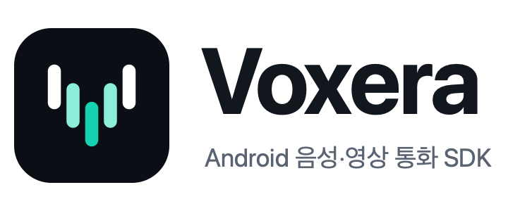
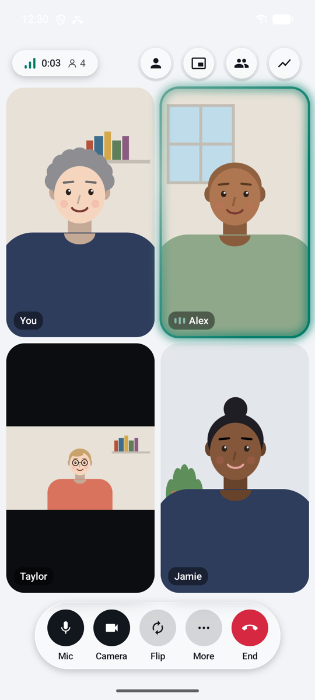
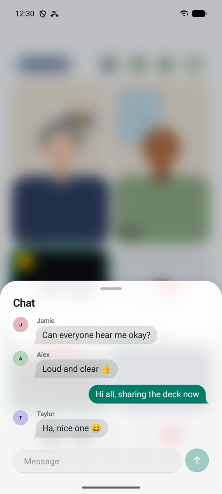

<p align="center">
  <picture>
    <source media="(prefers-color-scheme: dark)" srcset="docs/images/logo-dark.png">
    
  </picture>
</p>

<p align="center">
  <a href="https://central.sonatype.com/artifact/com.naurylab/voxera-core"></a>
  
  <a href="LICENSE"></a>
</p>

**Voxera**는 Android 앱에 음성 통화와 영상 통화를 화면까지 한 번에 붙이는 SDK입니다.
앱은 LiveKit 호환 서버 주소와 수명이 짧은 토큰만 넘기면 됩니다. 연결, 재연결, 상태 관리, 통화 화면은 SDK가 맡고, 통화 서버와 토큰 발급은 앱을 만드는 쪽이 운영합니다. Voxera가 따로 운영하는 서버는 없습니다.

<table>
  <tr>
    <td align="center" width="25%"><br><b>그룹 영상 통화</b><br>참가자마다 다른 영상 비율에 맞춰 놓음</td>
    <td align="center" width="25%"><br><b>9명, 어두운 테마</b><br>말하는 사람 테두리, 마이크 꺼짐 표시</td>
    <td align="center" width="25%"><br><b>채팅</b><br>뒤 화면이 흐려지는 시트</td>
    <td align="center" width="25%"><br><b>통화 품질</b><br>왕복 시간, 손실, 비트레이트 추이</td>
  </tr>
</table>

스크린샷 속 영상은 오프라인 데모가 코드로 그리는 일러스트입니다. 사람마다 생김새와 방이 다르고 눈을 깜빡이며 움직입니다. 실제 인물 사진은 SDK와 저장소에 넣지 않았습니다.

## 기능

- **통화 화면**: `VoxeraRoomScreen` 하나로 연결 중, 통화, 종료, 실패 화면까지 띄웁니다. 1:1은 상대를 전체 화면에, 나를 끌어 옮기는 작은 창에 두고, 3명부터는 격자, 9명을 넘으면 쪽을 넘겨 봅니다. 타일을 누르면 그 사람을 크게 봅니다.
- **영상 비율 맞춤**: 세로로 든 휴대전화와 가로 노트북 카메라가 섞여도, 조금만 잘리면 타일을 채우고 많이 잘리면 영상 전체를 보여 줍니다. 화면 공유는 글자가 잘리지 않게 늘 전체를 보여 줍니다.
- **통화 중 기능**: 채팅, 반응 이모지, 손들기, 화면 공유, 카메라 색 효과, 오디오 출력 전환(스피커, 수화부, 유선, 블루투스), 참가자 목록, 통화 품질 시트가 들어 있습니다.
- **입장 전 화면**: 음성과 영상을 고르고 카메라 미리보기와 마이크 레벨을 봅니다. 권한은 사용자가 켤 때만 묻습니다.
- **안정적인 상태 관리**: 재연결 제한 시간, 만료된 토큰 한 번 다시 받기, 빠르게 연타해도 어긋나지 않는 마이크와 카메라 상태, 이전 연결의 늦은 이벤트 버리기를 SDK가 처리합니다.
- **백그라운드와 시스템 연동**: 앱이 뒤로 가도 통화가 이어지고, 통화 알림에서 바로 끊을 수 있습니다. PiP 작은 창, 수화부로 들을 때 화면 끄기, 휴대전화가 오면 보류했다가 이어 가기를 지원합니다.
- **전화처럼 걸고 받기(Call Mode)**: 걸려 온 통화와 거는 통화 화면, 초대 상태 정리, 푸시 payload 파서가 있습니다. 초대 전송은 앱 서버가 맡습니다.
- **다른 클라이언트와 호환**: 채팅은 LiveKit 표준 채팅 형식이라 LiveKit Meet 같은 다른 클라이언트와도 주고받습니다.
- **접근성**: TalkBack 읽기 순서와 동작 이름, 글꼴 200%, 320dp 폭 화면, 고대비를 지원합니다. TalkBack이 켜져 있으면 조작 막대를 숨기지 않습니다.
- **테마**: 밝은 테마와 어두운 테마, 색 덮어쓰기를 지원합니다. 덮어쓴 색이 대비 기준에 못 미치면 기본색을 씁니다. 앱의 `MaterialTheme`는 건드리지 않습니다.
- **오프라인 데모와 테스트**: 네트워크 없이 도는 데모 통화와, 가상 시간으로 도는 가짜 엔진으로 통화 화면을 만들고 테스트합니다.
- **Java 지원**: Java 앱은 콜백 방식의 `VoxeraJava`를 씁니다.

## 샘플 앱

설치해서 바로 써 볼 수 있는 쇼케이스 앱을 [Releases](https://github.com/Naury74/Voxera-RTC-SDK/releases/latest)에 올려 두었습니다.

- [쇼케이스 앱 내려받기 (voxera-showcase.apk)](https://github.com/Naury74/Voxera-RTC-SDK/releases/latest/download/voxera-showcase.apk)
- Android 8.0(API 26) 이상에서 설치됩니다. 처음 설치할 때는 "출처를 알 수 없는 앱" 설치를 허용해야 합니다.
- 체험용 키로 서명했습니다. 새 버전이 덮어 설치되지 않으면 이전 앱을 지우고 다시 설치하세요.


첫 화면의 **오프라인 쇼케이스**에서 1:1 음성과 영상, 4명, 9명, 12명 그룹, 화면 공유, 불안정한 네트워크 통화를 네트워크 없이 둘러볼 수 있습니다. 데모 화면에는 늘 `DEMO` 표시가 붙습니다.

**걸고 받기**에서는 걸려 온 통화와 거는 통화 화면을 데모로 봅니다.

**내 LiveKit 연결**에서는 직접 운영하는 LiveKit 서버(또는 LiveKit Cloud)에 실제로 연결합니다. 토큰 엔드포인트, 이미 받아 둔 토큰, LiveKit Cloud 개발 토큰 서버 가운데 하나를 고릅니다.

<br clear="right">

## 설치

```kotlin
// settings.gradle.kts
dependencyResolutionManagement {
    repositories {
        google()
        mavenCentral()
        // LiveKit Android가 쓰는 audioswitch는 JitPack에만 있습니다. 그 그룹만 받게 제한해 두세요.
        maven("https://jitpack.io") { content { includeGroup("com.github.davidliu") } }
    }
}

// app/build.gradle.kts
dependencies {
    implementation("com.naurylab:voxera-livekit-compose:0.1.0-alpha01") // LiveKit 엔진 + 통화 화면
    implementation("com.naurylab:voxera-android:0.1.0-alpha01")         // 백그라운드 유지, PiP, 통화 알림
}
```

LiveKit으로 통화하고 Voxera 화면을 쓴다면 위 두 모듈이면 됩니다. 나머지는 필요할 때 더하세요. 모든 모듈은 같은 버전을 씁니다.

| 모듈 | 용도 |
| --- | --- |
| `voxera-livekit-compose` | LiveKit 영상을 통화 화면에 그리는 렌더러. `voxera-livekit`과 `voxera-ui-compose`를 함께 가져옵니다 |
| `voxera-livekit` | LiveKit Android SDK로 실제 통화를 하는 엔진, 토큰 공급자 |
| `voxera-ui-compose` | Compose 통화 화면, 입장 전 화면, 걸고 받기 화면, 테마 |
| `voxera-android` | 통화 중 백그라운드 유지, 통화 알림, PiP, 근접 화면 끄기, 시스템 통화 등록 |
| `voxera-invitation` | 걸고 받기(Call Mode) 계약과 상태 정리, 푸시 payload 파서 |
| `voxera-testkit` | 오프라인 데모 시나리오와 테스트용 가짜 엔진 |
| `voxera-core` | 진입점 `Voxera`와 통화 세션, Java 진입점 |
| `voxera-rtc-api` | 엔진에 매이지 않는 통화 모델, 오류, 토큰 공급자 계약 |

`voxera-core`와 `voxera-rtc-api`는 위 모듈이 알아서 가져옵니다. 화면을 직접 만들거나 다른 엔진을 붙일 때만 직접 씁니다.

- minSdk 26(Android 8.0), Java 17, Kotlin 2.2 이상에서 씁니다.
- 통화 화면은 같은 저자의 [Kinetica UI 키트](https://github.com/Naury74/Kinetica-Kit-SDK)로 시트, 알림, 블러, 움직임을 그립니다. 의존성으로 함께 들어오고, Voxera 공개 API에는 Kinetica 타입이 나오지 않습니다.
- 따로 R8 규칙을 넣지 않아도 됩니다. 배포한 라이브러리를 R8을 켠 release 앱으로 빌드해 확인하고 있습니다.
- 매니페스트에 합쳐지는 권한과 서비스는 [docs/permissions.md](docs/permissions.md)에 있습니다.

## 사용법

### 실제 통화

```kotlin
val engines = LiveKitRtcEngineFactory(applicationContext)
val voxera = Voxera.create(engines)          // 앱에서 하나
val session = voxera.createSession(
    VoxeraSessionConfig(credentials = RtcCredentialsProvider { request ->
        myBackend.liveKitCredentials(room = request.roomId) // 앱 서버가 짧은 토큰을 발급
    }),
)

scope.launch { session.join("support-42", CallMode.VIDEO) }

// Compose: LiveKit 영상 렌더러를 넘기고 통화 화면을 띄운다.
CompositionLocalProvider(LocalVoxeraVideoRenderer provides engines.videoTracks.asComposeRenderer()) {
    VoxeraRoomScreen(session = session, onExit = { navController.popBackStack() })
}
```

통화를 마치면 `session.leave()`, 세션을 다 쓰면 `session.close()`를 부릅니다. 입장 전 화면, 화면 공유, PiP, 통화 알림, 채팅을 직접 다루는 방법은 [연동 가이드](docs/integration.md)에 있습니다.

### 오프라인 데모

```kotlin
val session = VoxeraDemo.createFakeSession(DemoScenario.GROUP_FOUR)
scope.launch { session.join(VoxeraDemo.ROOM_ID, DemoScenario.GROUP_FOUR.mode) }

VoxeraRoomScreen(session = session, onExit = { })
```

데모 세션은 네트워크를 쓰지 않습니다. 화면에는 늘 `DEMO` 표시가 붙고, 품질 값도 시뮬레이션 값(`MetricSource.SIMULATED`)으로 나옵니다.

### 토큰과 보안

- LiveKit API Secret과 Signing Key는 앱, SDK, 저장소 어디에도 두지 않습니다. 토큰은 앱 서버가 발급합니다.
- 기본은 `wss://`만 받습니다. 로컬 개발 서버의 `ws://`는 `ServerUrlPolicy(allowInsecureLocalhost = true)`일 때만 쓰며, debug 빌드에서만 켜세요.
- SDK는 토큰을 메모리에만 두고 디스크와 로그에 남기지 않습니다. 토큰이 만료되면 한 번만 다시 요청하고, 앱 서버 인증 실패(401/403)는 다시 시도하지 않습니다.
- 채팅과 반응처럼 네트워크에서 온 값은 정해진 형식과 길이만 받습니다.

보안 정책과 취약점 알리는 방법은 [SECURITY.md](SECURITY.md)에 있습니다.

## 주의사항

- 통화 서버가 필요합니다. 직접 운영하는 LiveKit 서버나 LiveKit Cloud를 쓰고, 토큰을 발급하는 앱 서버를 준비하세요.
- 유리 표면의 블러는 Android 12(API 31) 이상에서만 보입니다. 그보다 낮은 기기와 배터리 절약 모드에서는 반투명한 색으로 대신 그립니다.
- 카메라 효과는 밝기, 대비, 채도 조절입니다. 배경 흐림이나 배경 바꾸기는 없습니다.
- 다른 사람의 마이크를 끄거나 내보내는 진행자 기능은 없습니다. LiveKit 서버 API가 필요한 일이라 앱 서버에서 하세요.
- 알파 버전이라 공개 API가 바뀔 수 있습니다. 바뀌는 내용은 [CHANGELOG](CHANGELOG.md)에 적습니다.

## 문서

| 문서 | 내용 |
| --- | --- |
| [연동 가이드](docs/integration.md) | 세션, 토큰 공급자, 통화 화면, 입장 전 화면, 백그라운드와 PiP, 걸고 받기, 진단, Java |
| [권한](docs/permissions.md) | 매니페스트에 합쳐지는 권한과 서비스, 런타임 권한, 로컬 개발 서버 |
| [아키텍처](docs/architecture.md) | 모듈 구조, 세션 상태 머신, 미디어 조작, 화면 구성 |
| [검증 기록](docs/verification.md) | 확인한 기기와 항목, 성능 측정값, 아직 확인하지 못한 것 |
| [변경 이력](CHANGELOG.md) | 버전마다 바뀐 내용 |

빌드와 기여 방법은 [CONTRIBUTING](CONTRIBUTING.md), 배포 절차는 [docs/publishing.md](docs/publishing.md)에 있습니다. API 문서는 `./gradlew :dokkaGenerate`로 만들 수 있고, 배포한 javadoc jar에도 들어 있습니다.

## License

Apache License 2.0으로 배포합니다. 전문은 [LICENSE](LICENSE)에 있습니다. 일부 아이콘은 [Material Icons](https://github.com/google/material-design-icons)에서 가져왔습니다([NOTICE](NOTICE)).
