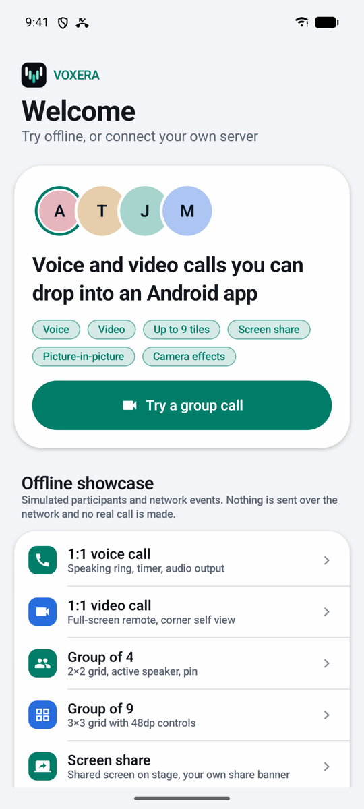
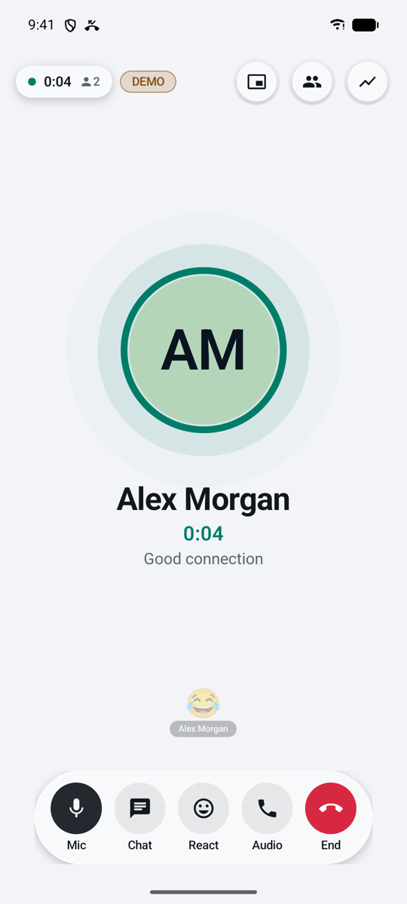
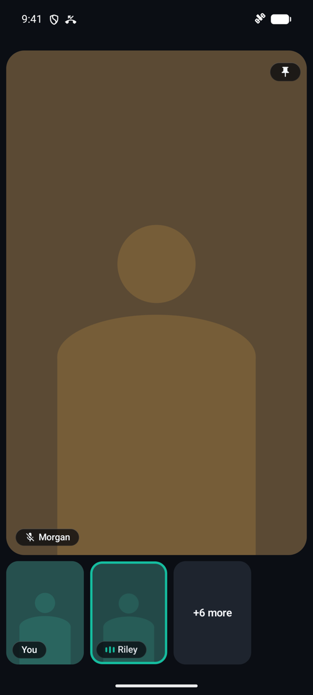
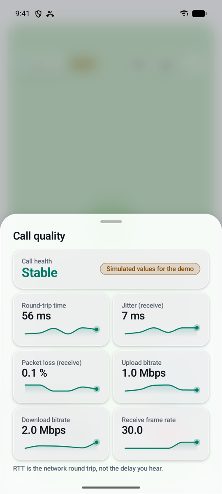

# Voxera RTC SDK

<p>
  
  
</p>

**Voxera**는 Android 앱에 음성·영상 통화 화면을 붙이는 UI 포함 RTC SDK입니다. 호스트 앱이 자신의 LiveKit 호환 서버 주소와
짧은 수명 토큰을 넘기면 룸 통화를 할 수 있도록 만드는 것이 목표입니다. SDK 제공자는 통화 서버를 운영하거나 토큰을 발급하지 않습니다.

> 현재 단계: **M1 vertical RTC 진행 중**. 오프라인 쇼케이스, 세션 상태 머신, Glass UI에 더해 실제 LiveKit 연결(BYO 설정,
> 음성·영상·음소거·재연결·품질 진단)이 들어 있습니다. 아래 표의 "검증"은 실제로 돌린 것만 적습니다([docs/verification.md](docs/verification.md)).

<table>
  <tr>
    <td align="center" width="25%"><br><b>홈</b><br>오프라인 쇼케이스</td>
    <td align="center" width="25%"><br><b>1:1 음성</b><br>발화 고리·통화 시간</td>
    <td align="center" width="25%"><br><b>9인 그룹 (다크)</b><br>3×3 격자·발화자 강조</td>
    <td align="center" width="25%"><br><b>통화 품질</b><br>송수신 분리·N/A·데모 표시</td>
  </tr>
</table>

화면의 영상은 데모용 추상 그라디언트이며 인물 이미지는 번들하지 않습니다.

## 모듈

| 모듈 | 종류 | 내용 |
| --- | --- | --- |
| `voxera-rtc-api` | Kotlin JVM | 엔진 중립 모델(`SessionState`, `Participant`, `VideoTrackHandle`, `QualitySnapshot`), `VoxeraError`, `RtcEngine` 포트, 서버 주소·토큰 입력 검사 |
| `voxera-core` | Kotlin JVM | `Voxera.create`, `VoxeraSession`, 세대 기반 상태 reducer |
| `voxera-livekit` | Android | LiveKit Android 2.29.0 기반 `LiveKitRtcEngineFactory`, 토큰 공급자(`LiveKitTokenSources`), 영상 트랙 조회 |
| `voxera-livekit-compose` | Compose | LiveKit 영상을 `VoxeraRoomScreen`에 그리는 렌더러 |
| `voxera-invitation` | Kotlin JVM | Call Mode: `InvitationGateway` 계약, `CallCoordinator`, 푸시 payload 파서 |
| `voxera-android` | Android | 통화 중 백그라운드 유지(`VoxeraForegroundCall`, foreground service·알림) |
| `voxera-testkit` | Kotlin JVM | `FakeRtcEngine`(가상 시간), `VoxeraDemo`·`DemoScenario` 오프라인 데모 |
| `voxera-ui-compose` | Compose | `VoxeraTheme`(Light/Dark Glass 토큰), `VoxeraRoomScreen`, 조작 막대·참가자 타일 |
| `app` | Showcase | 오프라인 쇼케이스. 배포하지 않음 |

구조와 결정 사항은 [docs/architecture.md](docs/architecture.md)에 있습니다.

## 빠른 시작 (오프라인 데모)

```kotlin
val session = VoxeraDemo.createFakeSession(DemoScenario.GROUP_FOUR)
scope.launch { session.join(VoxeraDemo.ROOM_ID, DemoScenario.GROUP_FOUR.mode) }

// Compose
VoxeraRoomScreen(session = session, onExit = { /* 호스트 내비게이션 */ })
```

데모 세션은 네트워크에 연결하지 않으며 화면에 항상 `DEMO`를 표시합니다. 품질 값은 `MetricSource.SIMULATED`입니다.

## 실제 통화 (호스트 토큰 공급자)

```kotlin
val engines = LiveKitRtcEngineFactory(applicationContext)
val sdk = Voxera.create(engines)
val session = sdk.createSession(
    VoxeraSessionConfig(credentials = RtcCredentialsProvider { request ->
        myBackend.getLiveKitCredentials(room = request.roomId) // 호스트 서버가 짧은 토큰 발급
    }),
)

// Compose: 실제 영상 렌더러를 넘긴다.
CompositionLocalProvider(LocalVoxeraVideoRenderer provides engines.videoTracks.asComposeRenderer()) {
    VoxeraRoomScreen(session = session, onExit = { /* 호스트 내비게이션 */ })
}
```

마이크·카메라 권한은 호스트가 입장 버튼을 누른 직후 요청합니다. 합쳐지는 권한과 런타임 요청 정책은 [docs/permissions.md](docs/permissions.md).

- API Secret·Signing Key를 앱·SDK·저장소에 넣지 않습니다. 토큰은 호스트 서버가 발급합니다.
- 기본으로 `wss://`만 허용하고, `ServerUrlPolicy(allowInsecureLocalhost = true)`일 때만 로컬 개발 주소에 `ws://`를 씁니다.
- `RtcCredentials.toString()`은 토큰을 가립니다. SDK는 토큰을 저장하지 않습니다.
- 만료 토큰은 `CredentialReason.REAUTHENTICATE`로 한 번만 다시 요청하고, 호스트 인증 실패(401/403)는 다시 시도하지 않습니다.

## 진행 현황

| 티켓 | 내용 | 상태 | 검증 |
| --- | --- | --- | --- |
| VOX-001 | Gradle 멀티모듈·버전 카탈로그 | 완료 | `test lint assembleDebug assembleRelease` 통과 |
| VOX-002 | API 모델·오류 체계 | 완료 | JVM 단위 테스트. binary API dump는 아직 없음 |
| VOX-003 | 세션 상태 reducer | 완료 | 전이·경합 JVM 테스트 |
| VOX-004 | Fake RTC Engine | 완료 | 1/3/8명 원격 참가자 시뮬레이션 테스트 |
| VOX-005 | 오프라인 쇼케이스 | 완료 | 에뮬레이터(API 36, 폴더블)에서 5가지 시나리오 수동 확인 |
| VOX-006 | 자격 증명·URL 검사 | 완료 | JVM 단위 테스트 |
| VOX-UI-001~003 | Glass 토큰·유리 표면·불투명 폴백 | 부분 | 테두리 반사광·배경 빛 번짐·캡슐 버튼·선택 알약·스위치로 개편, 대비 테스트 통과. API 26/30 실기기 확인 안 함 |
| VOX-007~009 | LiveKit 연결·참가자·마이크/카메라 어댑터 | 완료 | 매핑 JVM 테스트, 에뮬레이터+로컬 LiveKit 실통화 |
| VOX-010 | BYO 설정(개발 토큰 서버·기존 토큰·endpoint) | 부분 | 기존 토큰·endpoint는 로컬 서버로 확인. 개발 토큰 서버(LiveKit Cloud)는 확인 안 함 |
| VOX-011 | 입장 전 대기(권한·카메라 미리보기) | 완료 | 거부·영구 거부·설정 복귀를 에뮬레이터에서 확인. 마이크 레벨 표시는 없음 |
| VOX-019 | 백그라운드 통화 유지·PiP | 부분 | foreground service 녹음 유지, PiP 자동 진입·마이크 버튼·복귀를 Fold7 실통화로 확인. Telecom 연동은 안 함 |
| VOX-022~024 | Call Mode 계약·가짜 호스트 샘플·수신 화면 | 완료 | 경합 JVM 테스트, 데모 화면 확인. 실제 호스트 서버·푸시는 확인 안 함 |
| VOX-025 | Java facade | 완료 | Java 소스 테스트 |
| VOX-014 | 실제 영상 렌더링 | 완료 | 에뮬레이터에서 원격·로컬 영상 확인 |
| VOX-016 | 재연결·오류 화면 | 완료 | 서버 강제 종료 후 Reconnecting → Failed, 다시 시도 |
| VOX-020 | 품질 진단(실제 통계) | 완료 | 샘플러 JVM 테스트, 실통화 값 표시 |
| VOX-018 | 화면 공유 | 완료 | 에뮬레이터 실통화에서 시작·승인 취소·시스템 중지 확인 |
| VOX-021 | 진단 리포트(로컬 JSON) | 완료 | 민감 값 제외 JVM 테스트, 실제 저장 파일 확인 |
| VOX-017 | 카메라 색 효과(밝기·대비·채도) | 부분 | 에뮬레이터에서 게시·적용·폴백 확인. Fold7에서 프레임당 5.0~7.8ms(예산 15ms) |
| VOX-026 | 접근성·작은 화면·큰 글꼴 | 부분 | 320dp·200% 테스트와 에뮬레이터 확인, TalkBack 읽기 순서 지정. 실제 TalkBack 사용 점검은 안 함 |
| VOX-028 | 배포 리허설 | 부분 | 로컬 Maven + `samples/consumer`. Maven Central 게시는 라이선스 결정 전이라 안 함 |
| VOX-027 | 기기·API 매트릭스 | 부분 | API 26·36 에뮬레이터, Fold7(API 36) 실기기 확인. 30·31·33~35는 안 함 |
| VOX-015 | 장치 전환 실기기 검증 | 부분 | Fold7 스피커↔휴대전화↔블루투스, 블루투스 끊김·재연결, 백그라운드 마이크 확인. 유선은 안 함 |
| VOX-029 | 공개 문서·라이선스 | 미착수 | - |
| 추가 | 통화 중 반응, 통화 알림(경과 시간·종료), 수화부 근접 화면 끄기, 발열·다른 통화 대응 | 부분 | 반응 전송·알림 종료·다른 통화 안내를 에뮬레이터 실통화로 확인. 반응 수신(실통화)·근접 센서는 실기기 필요 |

## 빌드

JDK는 Android Studio에 포함된 JBR을 씁니다.

```bash
export JAVA_HOME="/Applications/Android Studio.app/Contents/jbr/Contents/Home"
./gradlew test lint :app:assembleDebug :app:assembleRelease
```

AGP 9.4.1, Kotlin 2.4.20, compileSdk/targetSdk 37, minSdk 26. 버전은 `gradle/libs.versions.toml`에서만 관리합니다.

## 알려진 제한

- 실기기 2대 통화, LiveKit Cloud, 블루투스·유선 전환은 아직 검증하지 않았습니다(에뮬레이터 + 로컬 서버 + CLI 봇만 확인).
- 배경 흐림(backdrop blur)은 하지 않습니다. 영상 Surface 뒤를 흐리게 하는 보편적인 Android 방법이 없어 반투명 tint·테두리로 대신합니다.
- TalkBack·글꼴 200%·태블릿 레이아웃은 기본 의미 정보와 최소 터치 영역만 반영했고 기기별 점검은 하지 않았습니다.
- 공개 라이선스는 아직 정하지 않았습니다([NOTICE](NOTICE)).
